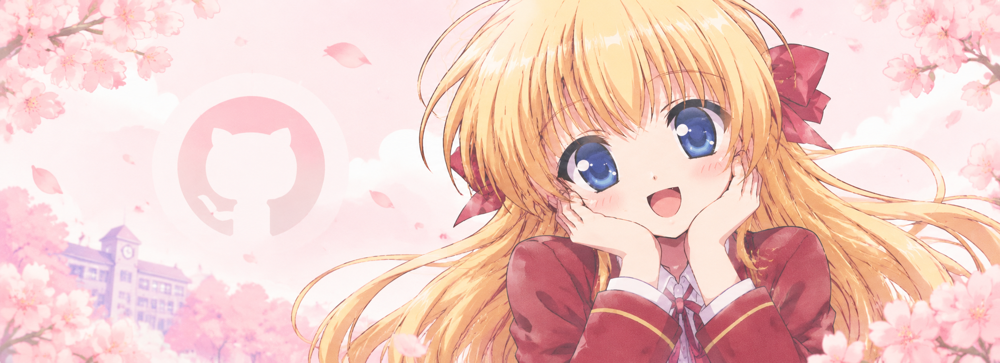

 <!-- ============================== -->
<!--       FUJIMIYA RIRI PROFILE       -->
<!-- ============================== -->

<p align="center">
  
</p>

<h1 align="center">こんにちは！藤宮 りりです ♡</h1>

<p align="center">
  <i>A little world of code, creativity and dreams.</i>
</p>

<p align="center">
  
  
  
</p>

---

## ♡ About Me

```yaml
name: Fujimiya Riri
nickname: りり
role: Indie Developer

focus:
  - Desktop Applications
  - AI & Agent Development
  - Open Source Projects
  - Web Development

tech:
  - Rust
  - TypeScript
  - React
  - Tauri

interests:
  - Anime & Visual Novels
  - Creative Coding
  - Open Source
```

## ♡ Tech Stack

<p align="center">
  
</p>

## ♡ Featured Projects

<p align="center">
  <a href="https://github.com/YOUR_GITHUB_USERNAME/PROJECT_ONE">
    
  </a>
  <a href="https://github.com/YOUR_GITHUB_USERNAME/PROJECT_TWO">
    
  </a>
</p>

## ♡ GitHub Statistics

<p align="center">
  
  
</p>

## ♡ Contribution Activity

<p align="center">
  
</p>

---

<p align="center">
  <i>「小さな一歩が、未来を変える。」</i>
</p>

<p align="center">
  Thanks for visiting my profile! ♡
</p>

<p align="center">
  <sub>Made with love by Fujimiya Riri 🌸</sub>
</p>
